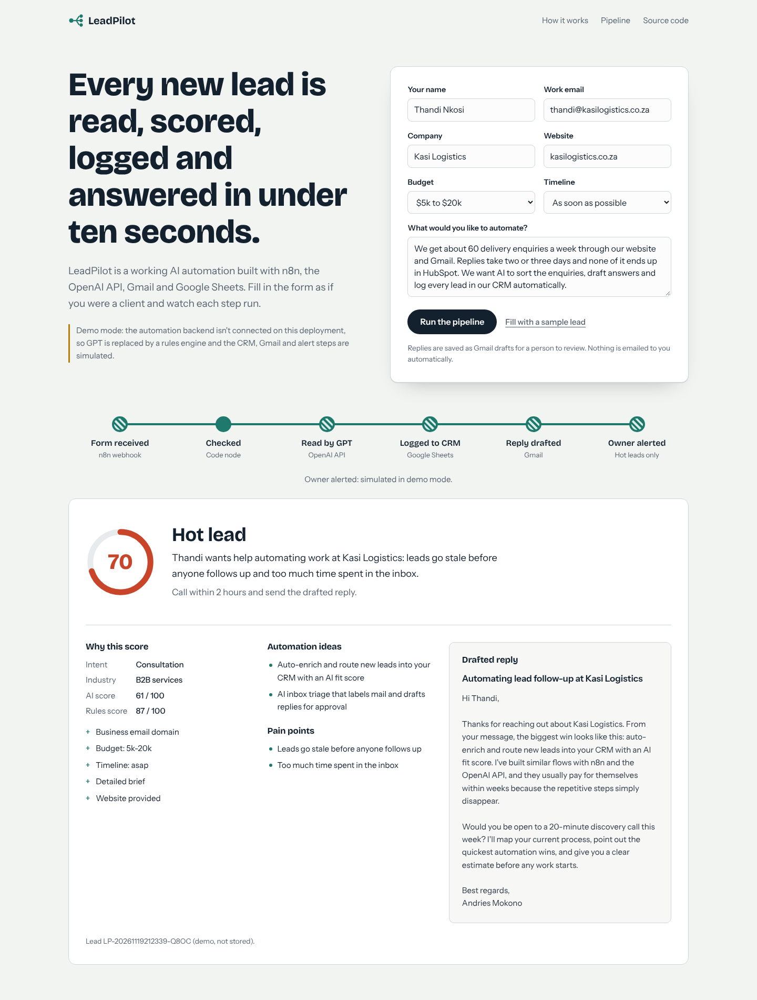
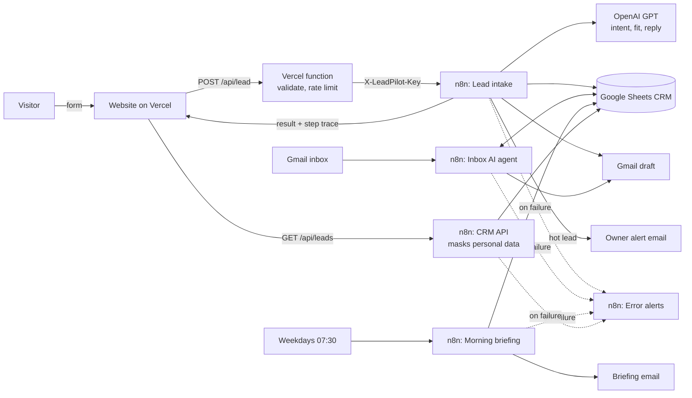

# LeadPilot AI

**Every new lead is read, scored, logged and answered in under ten seconds.**

LeadPilot is a production-style AI automation system for inbound sales leads. A website form feeds an n8n pipeline that uses the OpenAI API to qualify each lead, blends the AI judgement with rule-based signals into one score, logs everything to a Google Sheets CRM, drafts a personalised Gmail reply for human approval and alerts the owner about hot leads. An AI agent triages the Gmail inbox, a scheduled workflow emails a morning pipeline briefing, and an error workflow reports failures.

Live demo: `https://YOUR-PROJECT.vercel.app` · Built by **[Andries Mokono](https://www.linkedin.com/in/andries-mokono)**, software engineer, applied AI (Gauteng, South Africa) · [GitHub](https://github.com/drico999)



---

## What it covers

| Skill | Where it lives |
|---|---|
| n8n workflow automation | 5 importable workflows in [`n8n/workflows/`](n8n/workflows) |
| AI agents | Inbox triage agent with 3 tools: CRM lookup, CRM update, Gmail draft (`2-inbox-agent.json`) |
| ChatGPT / OpenAI API | GPT lead qualification in JSON mode, agent reasoning, written briefings |
| Gmail and email automation | Gmail trigger, threaded drafts, HTML alerts and daily briefing emails |
| CRM and lead generation | Lead capture form, AI + rules scoring, Google Sheets CRM with status tracking |
| Google Sheets and API integrations | Append, lookup, upsert and read via n8n; REST endpoint for the dashboard; Vercel serverless API |
| Business process automation | Full lead lifecycle: capture → qualify → log → respond → follow up → report |
| Make / Zapier | Module-by-module mapping in [`docs/MAKE-ZAPIER.md`](docs/MAKE-ZAPIER.md) |

## Architecture



### The five workflows

1. **Lead intake and qualification**: webhook → validate → GPT (JSON mode) → score = 65% AI + 35% rules → append to CRM → alert owner if hot → Gmail draft → respond with a step-by-step trace.
2. **Inbox triage agent**: Gmail trigger → AI Agent with tools *Find lead in CRM*, *Update lead status*, *Draft reply* → log decision to the *Inbox Log* tab. The agent can draft but never send.
3. **Morning pipeline briefing**: weekdays at 07:30, reads the CRM, computes stats, GPT writes a short briefing, emails an HTML summary with the leads to call first.
4. **CRM API**: authenticated GET webhook that feeds the public pipeline page. First names only, no emails or messages leave n8n.
5. **Error alerts**: Error Trigger → formatted email with the failing node, message and execution link.

### Design decisions

- **Human in the loop.** Replies are Gmail drafts. Auto-sending from a public form would let anyone use your mailbox to email strangers.
- **Explainable scoring.** GPT supplies 65% of the score; budget, timeline, business email, detail and website supply 35%. Rules live in [`lib/scoring.js`](lib/scoring.js) and are shared by the website, the n8n Code nodes and the tests.
- **No secrets in the browser.** The site calls a Vercel function, which validates, rate-limits and forwards with a shared header key. OpenAI and Google credentials live only in n8n.
- **Graceful failure.** CRM and Gmail steps continue on error, so a lead is never lost and the visitor still gets a result. If GPT fails, the lead is scored on rules alone.
- **Demo mode.** With no n8n URL configured the site still works, using a rules engine and clearly labelled simulated steps, so you can deploy the front end first.

## Repository layout

```
api/                 Vercel serverless functions (/api/lead, /api/leads) + demo-mode engine
lib/scoring.js       Validation and scoring rules (single source of truth)
lib/prompts.js       Every LLM prompt, versioned in code
n8n/code/            Readable source for each n8n Code node
n8n/workflows/       Generated, importable n8n workflow JSON
n8n/sheets-template/ Column headers for the Leads and Inbox Log tabs
public/              Website: live demo + pipeline dashboard
scripts/             Workflow generator and a zero-dependency local server
tests/               32 tests: scoring, API, and every Code node run in a harness
docs/                Deployment guide, Make/Zapier mapping, portfolio copy
```

## Run it locally

Requires Node.js 22 or newer.

```bash
npm test          # 32 tests
npm start         # http://localhost:3000 in demo mode
```

To connect a real backend, copy `.env.example` to `.env`, fill in the `N8N_*` values and run `npm start` again.

## Deploy

Full step-by-step guide: **[docs/DEPLOY.md](docs/DEPLOY.md)**. In short:

1. Run n8n (n8n Cloud, or `docker compose up -d` on a small VPS).
2. Create the Google Sheet with tabs **Leads** and **Inbox Log** (headers in `n8n/sheets-template/`).
3. Set `OWNER_EMAIL` and `SHEET_ID` in `.env`, run `npm run build:workflows`, import the 5 JSON files into n8n.
4. Connect the OpenAI, Gmail, Google Sheets and Header Auth credentials, then publish the workflows.
5. Import this repo into Vercel and set `N8N_LEAD_WEBHOOK_URL`, `N8N_LEADS_WEBHOOK_URL` and `N8N_WEBHOOK_SECRET`.

## Changing the workflows

Edit the readable sources (`n8n/code/*.js`, `lib/*.js`), then:

```bash
npm run build:workflows && npm test
```

and re-import the changed JSON into n8n. Workflow JSON is generated, so keep edits in the sources.

## Testing notes

- `npm test` runs the scoring rules, both API functions (demo and live, with a stubbed n8n) and every n8n Code node against realistic inputs, including OpenAI failure, spam, HTML injection and empty sheets.
- The workflows were imported into n8n 2.48 and every node's parameters were checked against n8n's own node definitions. The lead-intake and CRM API webhooks were run end to end against a mock OpenAI endpoint. The Google Sheets, Gmail and agent tool steps need your real Google account, so test them once after connecting credentials (see the checklist in `docs/DEPLOY.md`).

## License

MIT © Andries Mokono
